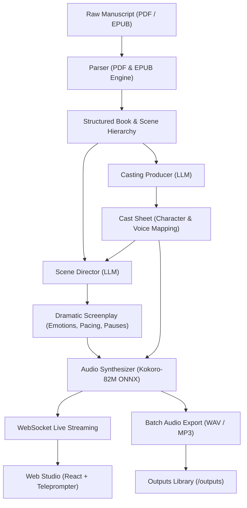

# 🎭 Ensemble: Autonomous Multi-Cast Audio Drama Engine

[](https://www.python.org/downloads/)
[](https://fastapi.tiangolo.com)
[](https://github.com/thewh1teagle/kokoro-onnx)
[](https://react.dev/)
[]()
[]()

**Ensemble** is an end-to-end, autonomous multi-cast audio drama studio that turns standard fiction manuscripts (PDF or EPUB) into cinematic, full-cast audio performances. 

Unlike traditional single-narrator audiobooks or robotic TTS converters, Ensemble operates like a professional Hollywood production crew: an **AI Casting Producer** analyzes character personalities and casts unique neural voices, an **AI Scene Director** translates prose into dramatic screenplays with line-by-line emotional direction and natural pacing, and an **Expressive Neural Synthesizer** delivers broadcast-ready audio in real-time.

---

## 🌟 Key Features

- **Automated Book & Scene Parsing**:
  - Ingests raw **PDF** and **EPUB** books with intelligent TOC extraction and layout-aware header/footer stripping.
  - Automatically segments chapters into natural narrative scenes (600–1,400 words) at section breaks (`* * *`, blank dividers, narrative scene shifts).

- **AI Casting Producer**:
  - Analyzes the full manuscript to extract characters, archetypes, gender, estimated age, vocal traits, and relational dynamics.
  - Automatically assigns matching distinct voices from the neural voice catalog to each character and the narrator.
  - Generates reusable, editable JSON `cast_sheet.json` files.

- **AI Scene Director**:
  - Converts narrative text into structured dialogue and narrative lines (`ScreenplayLine`).
  - Infers fine-grained emotional tags (*reflective*, *breathless*, *whispering*, *commanding*, *wistful*, *panicked*).
  - Regulates speech pacing multipliers (0.9×–1.2×) and dynamic post-line dramatic pauses (200ms–800ms).
  - Maintains rolling multi-scene memory to resolve pronoun ambiguities ("he said", "she replied") and ensure character continuity across chapter boundaries.

- **High-Performance Neural Synthesis (Kokoro-82M ONNX)**:
  - Sub-second line synthesis with Kokoro-82M.
  - Hardware accelerated via **NVIDIA CUDA/cuDNN** with automatic fallback to tuned multi-threaded CPU inference.
  - Exports to lossless **WAV** or high-fidelity **MP3**.

- **Interactive Web Studio & Live Streaming Player**:
  - **Live WebSocket Pipeline**: Streams screenplay text and synthesized voice lines into your browser with zero perceptible delay.
  - **Studio Glass UI**: Dark glassmorphic interface with a live synchronized teleprompter, dynamic audio visualizer, chapter selector, and pre-roll indicators.
  - **`[ Book | Chapter ]` Production Toggle**: Direct and stream the entire book continuously from chapter to chapter or focus on a single chapter.
  - **Interactive Casting Studio**: Inspect cast profiles, audition voices with custom preview lines, and swap actor assignments in real-time.
  - **Session Isolation**: Multi-user isolated workspaces for uploaded manuscripts, custom cast sheets, and audio exports.

- **Unified CLI & Automation**:
  - Run headless batch jobs to produce an entire novel with auto-resume support, or listen live to streaming chapters from the terminal.

---

## 🏗️ Architecture & Pipeline Flow



---

## 🚀 Quick Start

### 1. Prerequisites

- **Python**: 3.12 or higher
- **Node.js**: 18+ (for building the frontend, pre-built distribution included)
- **uv** (recommended) or standard `pip` / `virtualenv`
- **NVIDIA GPU** with CUDA 12+ (optional, runs smoothly on CPU)

### 2. Clone and Setup Environment

```bash
git clone https://github.com/Manish-Anchan/Ensemble.git
cd Ensemble

# Create virtual environment and install dependencies
uv sync
# Or with standard pip:
# python3 -m venv .venv && source .venv/bin/activate && pip install -e .
```

### 3. Download Kokoro Neural Models

Ensemble uses Kokoro-82M ONNX weights and voice vectors:

```bash
make download-models
```
*(Or manually download `kokoro-v1.0.onnx` [325MB] and `voices-v1.0.bin` [28MB] into the `models/` folder).*

### 4. Configure Environment Variables

Copy the example environment file:

```bash
cp .env.example .env
```

Edit `.env` with your preferred LLM provider for the Director and Producer:

```ini
# Scene Director (Google Gemini recommended for high TPM and long context)
DIRECTOR_API_KEY=your_gemini_api_key
DIRECTOR_BASE_URL=https://generativelanguage.googleapis.com/v1beta/openai/
DIRECTOR_MODEL=gemini-2.5-flash

# Casting Producer (Groq, Cerebras, OpenAI, or Gemini)
PRODUCER_API_KEY=your_groq_api_key
PRODUCER_BASE_URL=https://api.groq.com/openai/v1
PRODUCER_MODEL=qwen/qwen3.8-27b
```

> **Compatible LLM Providers**: Any OpenAI-compatible endpoint works out of the box (Google AI Studio, Groq, OpenAI, Anthropic via proxy, Cerebras, DeepSeek, or local Ollama).

---

## 🌐 Launching the Web Studio

To launch the web interface:

```bash
ensemble web
# Or using make:
make web
```

Open your browser at **`http://localhost:8080`**.

### Studio Interface Highlights:
- **Manuscript Library**: Switch between pre-loaded classics (*The Great Gatsby*, *The Time Machine*) or upload your own PDF/EPUB.
- **Voice Casting Studio**: Review characters, audit their assigned Kokoro voice profiles, and audition lines on the fly.
- **Live Teleprompter**: Watch the screenplay unfold line-by-line with real-time speaker badges, emotional tags, and word highlighting synced to audio.
- **Scope Toggle**: Switch between **`Book`** (streams all chapters continuously) and **`Chapter`** (streams only the active chapter).

---

## 💻 CLI Usage Guide

Ensemble includes a unified command-line interface for batch processing, casting, and terminal playback.

### 1. Launch Web Studio
```bash
ensemble web [--port 8080]
```

### 2. Batch Produce Full Audiobooks to Disk
Produce an entire book into chapter-by-chapter audio files:
```bash
# Produce all chapters in MP3 format (auto-resumes if interrupted)
ensemble produce samples/the_great_gatsby.pdf --all --mp3

# Produce specific chapter in WAV
ensemble produce samples/the_great_gatsby.pdf --chapter 1

# Produce chapter range (e.g., chapters 2 through 5)
ensemble produce samples/the_great_gatsby.pdf --start-chapter 2 --end-chapter 5
```

### 3. Stream Live Audio Drama to Speakers
Listen directly from the terminal with a real-time jitter buffer:
```bash
# Stream Chapter 1 to system speakers
ensemble samples/the_great_gatsby.pdf --chapter 1 --play

# Stream only the first scene for quick testing
ensemble samples/the_great_gatsby.pdf --chapter 1 --scenes 1 --play
```

### 4. Run AI Casting Producer Headless
Analyze character profiles and generate a `cast_sheet.json`:
```bash
ensemble cast samples/the_great_gatsby.pdf
```

### 5. Screenplay Directing Only (Dry Run)
Generate screenplays without performing speech synthesis:
```bash
ensemble produce samples/the_great_gatsby.pdf --chapter 1 --script-only
```

---

## 🎙️ Available Kokoro Voices

Ensemble maps characters across a versatile catalog of American and British voice profiles:

| Voice ID | Accent | Gender | Suggested Character Archetypes |
| :--- | :--- | :--- | :--- |
| `bm_george` | British | Male | Classic Narrator, aristocracy, formal gentlemen |
| `am_adam` | American | Male | Protagonist, modern leads, earnest young men |
| `am_michael`| American | Male | Authority figures, detectives, middle-aged men |
| `af_bella` | American | Female | Romantic leads, refined young women, Daisy |
| `af_sarah` | American | Female | Bright, energetic, sharp heroines |
| `bf_emma` | British | Female | Elegant narrators, formal ladies, intellectual leads |
| `bm_lewis` | British | Male | Eccentric, animated, expressive figures |
| `am_echo` | American | Male | Mysterious, soft-spoken, contemplative figures |

---

## 🛠️ Project Structure

```text
ensemble/
├── frontend/                     # React 19 + TypeScript + Vite Studio UI
│   ├── src/
│   │   ├── App.tsx               # Main Studio container, teleprompter, & dock
│   │   └── studio-glass.css      # Dark glassmorphism studio theme
│   └── package.json
├── models/                       # Kokoro ONNX model weights and voice vectors
├── samples/                      # Sample PDF/EPUB books & pre-computed cast sheets
├── src/ensemble/
│   ├── __init__.py               # Unified CLI dispatcher (ensemble web, produce, cast)
│   ├── audio/
│   │   └── synthesizer.py        # Kokoro-82M ONNX inference engine (CUDA + CPU)
│   ├── director/
│   │   ├── director.py           # LLM Scene Director & continuity tracker
│   │   └── models.py             # Screenplay and ScreenplayLine schemas
│   ├── drama/
│   │   └── producer.py           # Batch multi-chapter production orchestrator
│   ├── parser/
│   │   ├── pdf.py                # PyMuPDF parser with margin clipping & scene chunking
│   │   └── epub.py               # EPUB chapter extraction & TOC parsing
│   ├── producer/
│   │   └── producer.py           # LLM Casting Producer & voice assignment
│   └── web/
│       ├── app.py                # FastAPI REST endpoints & WebSocket live stream
│       └── dist/                 # Pre-built production frontend assets
├── tests/                        # 42 unit & integration tests
│   ├── test_director.py
│   ├── test_parser.py
│   ├── test_producer.py
│   ├── test_synthesizer.py
│   └── test_web.py
├── Makefile                      # Convenient shorthand developer commands
├── pyproject.toml                # Project metadata and dependencies
└── README.md
```

---

## 🧪 Running Tests

The test suite includes 42 automated tests covering parser chunking, casting logic, screenplay generation, ONNX synthesis, and WebSocket streaming:

```bash
# Run complete test suite
pytest

# Run with verbose output
pytest -v
```

---

## 📄 License

This project is licensed under the MIT License — see the [LICENSE](LICENSE) file for details.
